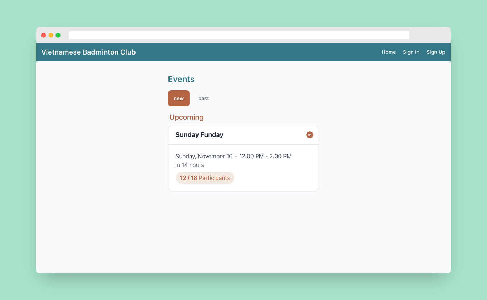

# VN Badminton Club

Event sign-up app for a community badminton club. Organizers post sessions; members join, leave, and bring guests; moderators manage the roster.



## Features

- **Events**: create, edit, and cancel sessions with date, time, and slot limits
- **Sign-ups**: members join or leave with one tap; the participant list is shown in sign-up order
- **Guests**: members can add or remove guests under their name
- **Moderation**: role-based moderator tools to remove participants and guests
- **Auth**: email sign-up and sign-in with Firebase Auth and server-side sessions
- **Content**: static pages managed through Decap CMS (`/admin`)
- **Installable**: PWA manifest and icons

## Tech stack

Next.js 14 (App Router, Server Actions, Route Handlers) · TypeScript · Firebase Auth and Firestore (`firebase-admin` on the server) · Tailwind CSS and Flowbite · Zod · Decap CMS

## Getting started

Prerequisites: Node.js 20+, Yarn, and a Firebase project with Auth (email/password) and Firestore enabled.

```bash
yarn install
cp .env.example .env.local   # fill in the Firebase and site values
yarn dev             # http://localhost:3000
```

| Variable | Purpose |
|---|---|
| `FIREBASE_PROJECT_ID`, `FIREBASE_CLIENT_EMAIL`, `FIREBASE_PRIVATE_KEY` | Firebase Admin service account (server only) |
| `NEXT_PUBLIC_FIREBASE_*` | Firebase web app config |
| `SITE_TITLE`, `SITE_SHORT_TITLE`, `SITE_DESCRIPTION` | Site metadata |

To edit CMS content locally, run `yarn decap` alongside `yarn dev` and open `/admin`.

## Project structure

```text
src/
  app/          # routes: events, sign-in/up, and API route handlers under app/api
  actions/      # server actions (auth, events)
  firebase/     # client and admin SDK setup, Firestore definitions
  lib/          # validation, sessions, caching, shared utilities
  components/   # UI components
content/        # Decap CMS markdown content
```
